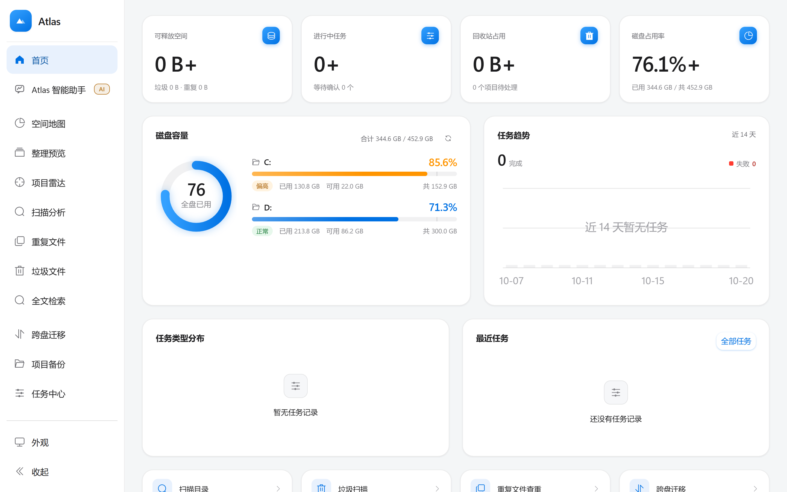

# Atlas

  <a href="README.md">简体中文</a> ·
  <a href="README.en.md">English</a> ·
  <a href="README.ja.md">日本語</a> ·
  <b>한국어</b> ·
  <a href="README.de.md">Deutsch</a> ·
  <a href="README.ru.md">Русский</a> ·
  <a href="README.es.md">Español</a>

**C 드라이브가 꽉 찼다면, 먼저 안을 들여다보세요.**

Windows용 디스크 정리 및 파일 관리 도구입니다. 스캔 분석, 중복 파일 탐지, 정크 파일 정리, 드라이브 간 이동, 공간 지도를 제공합니다.

파일을 쓰는 작업은 대상 목록을 먼저 보여주고 확인을 기다립니다. 기본 정리는 격리 영역으로 옮겨 되돌릴 수 있으며, 되돌릴 수 없는 작업은 명시하고 추가 확인을 요구합니다.
AI는 요청을 이해하고 계획만 세웁니다. 실제로 파일을 다루는 것은 로컬 코드입니다.
Agent 모델 요청과 사용자가 직접 요청한 AI 설명을 제외하면 스캔, 중복 검사, 정리, 이동, 백업은 로컬에서 실행됩니다. 계정은 필요 없습니다.

> 대신 결정해 주는 것이 아니라, "이 작업이 어떤 파일을 건드리는지"를 그대로 보여줍니다.

## 시작하기

1. [Atlas-2.1.0-win64-portable.zip](https://github.com/whalevoyage/wenjianguanli/releases/latest)을 내려받아 원하는 위치에 압축을 풉니다 (예: `D:\Atlas`)
2. `Atlas\Atlas.exe`를 더블클릭합니다
3. 브라우저가 자동으로 열립니다. 콘솔 창은 나타나지 않습니다.

Python이나 Node 같은 런타임은 필요 없습니다. `127.0.0.1`에서만 수신하며, 데이터는 `%LOCALAPPDATA%\Atlas`에 저장됩니다.
제거하려면 그 폴더를 삭제하면 됩니다.

**다시 더블클릭해도 새 인스턴스가 뜨지 않습니다** — 이미 실행 중인 화면을 브라우저로 엽니다.
**포트 8000이 사용 중이면 빈 포트로 자동 전환**되며, 실제 주소는 로그에 기록됩니다.

## 주요 기능

| 페이지 | 기능 |
| --- | --- |
| 홈 | 디스크 용량, 확보 가능한 공간, 작업 통계, 최근 작업 |
| Atlas 어시스턴트 | 자연어로 조작. 파일 작업을 우선 처리하고 일반 질문에도 답변 |
| 공간 지도 | 트리맵으로 폴더 용량 표시, 단계별 드릴다운 지원 |
| 정리 미리보기 | 유형·시간·크기·프로젝트별로 정리 결과를 미리보기 (읽기 전용) |
| 프로젝트 레이더 | 프로젝트 폴더를 감지해 유형·용량·파일 수·장기 미사용 여부 표시 |
| 스캔 분석 | 개수·용량·유형 분포·대용량 파일·장기 미접근 파일. 스냅샷으로 전후 비교 |
| 중복 파일 | 바이트 단위로 중복 탐지. 「유사 이미지」 지원 (축소·재압축·다른 이름 저장본, 회전 허용 옵션) |
| 정크 파일 | 임시 파일·로그·캐시·빈 폴더·0바이트 파일을 3단계 위험도로 탐지 |
| 전체 텍스트 검색 | 폴더별 로컬 FTS5 인덱스 생성, 파일명과 본문 검색 |
| 드라이브 간 이동 | 복사 후 항목별 검증, 검증을 통과해야 원본 처리. 롤백 지원 |
| 프로젝트 백업 | ZIP 스냅샷 생성 (의존성·빌드 폴더 제외). 복원 확인 지원 |
| 작업 센터 | 실시간 진행률·오류·취소·롤백 상태 확인 |
| 휴지통 | 삭제는 우선 격리 영역으로. 원래 위치로 복원 가능 |
| 작업 로그 | 감사 기록 조회 및 내보내기 |

## 안전 설계

- 삭제는 목록을 만든 뒤 확인을 받아 격리 영역으로 옮깁니다. 물리 삭제를 바로 하지 않습니다.
- 이동은 복사와 검증이 먼저이고, 검증을 통과한 뒤에 원본을 처리합니다.
- 오래 걸리는 작업은 백그라운드 작업으로 실행되며 진행률 확인·중단·롤백이 가능합니다.
- 프로젝트 자체 폴더, 상태 폴더, 격리 영역은 보호됩니다.
- 시스템 폴더는 기본적으로 스캔하지 않습니다. 표준 모드는 쓰기를 차단하며, 완전 액세스는 사용자가 명시적으로 보호를 완화할 수 있습니다. Atlas 자체 데이터와 격리 영역은 계속 보호됩니다.
- 기본적으로 `node_modules`, `.git`, `__pycache__`, `.venv`, `dist`, `build` 등을 제외합니다.
- 이동·백업 전에 대상의 여유 공간을 확인합니다.
- `127.0.0.1`에서만 수신하며 LAN에 노출하지 않습니다.

## 문서 안내

이 페이지는 **요약판**입니다. 자세한 내용(아키텍처, 설정, 테스트, 제약)은 아래를 참고하세요.

- 영어판 (전체 16장): [README.en.md](README.en.md)
- 중국어판 (원본): [README.md](README.md)

보안과 개인정보는 [SECURITY.md](SECURITY.md) / [PRIVACY.md](PRIVACY.md)를 참고하세요 (모두 중국어).

## 라이선스

[MIT License](LICENSE). 저작권과 라이선스 고지를 유지하면 자유롭게 사용·수정·재배포할 수 있습니다.
