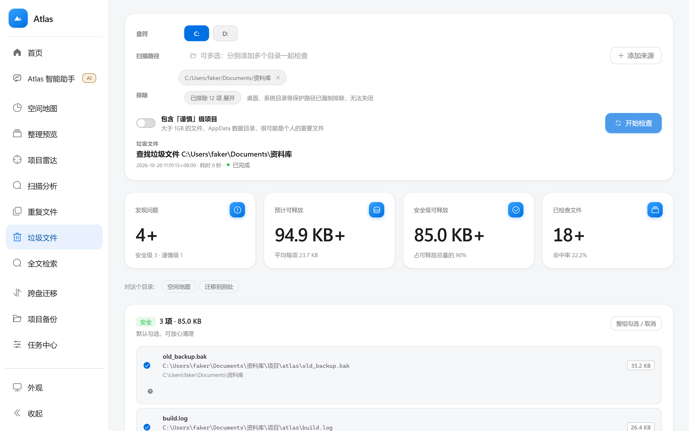
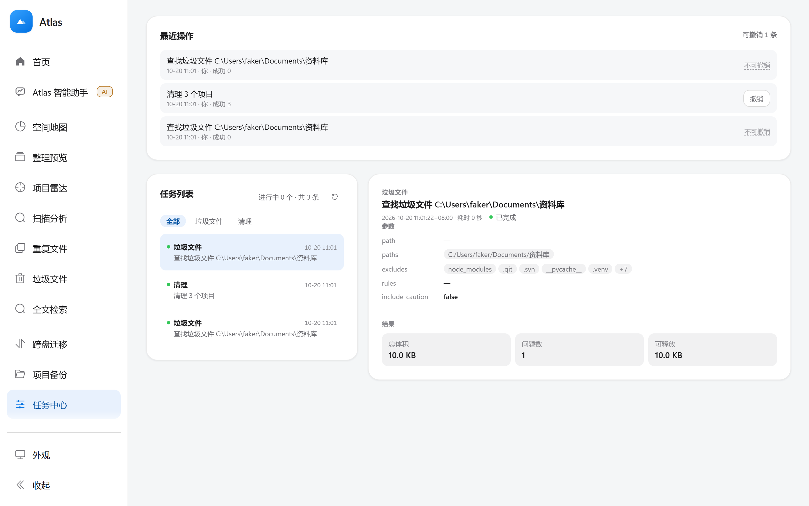

# Atlas

<p align="center">
  <b>简体中文</b> ·
  <a href="README.en.md">English</a> ·
  <a href="README.ja.md">日本語</a> ·
  <a href="README.ko.md">한국어</a> ·
  <a href="README.de.md">Deutsch</a> ·
  <a href="README.ru.md">Русский</a> ·
  <a href="README.es.md">Español</a>
</p>

**C 盘满了，先看清再动手。**

Windows 上的磁盘清理与文件管理工具：扫描分析、重复文件、垃圾清理、跨盘迁移、空间地图。

文件写操作会先展示清单并等待确认。默认清理先进隔离区，可撤销；不可逆操作会明确标记并要求额外确认。
AI 只负责听懂你说的话、生成计划 —— 真正碰文件的是本地代码。
除 Agent 模型请求和用户主动触发的 AI 解释外，扫描、查重、清理、迁移、备份等均在本地完成；无需账号。

> 它不替你做决定，只把「这一下会动哪些文件」摊开给你看。


## 快速开始

### 普通用户：解压即用（推荐）

1. 下载 [Atlas-2.1.0-win64-portable.zip](https://github.com/whalevoyage/wenjianguanli/releases/latest) 并解压到任意位置（比如 `D:\Atlas`）
2. 双击 `Atlas\Atlas.exe`
3. 程序**自动打开浏览器**进入界面。不会弹控制台窗口。

不需要安装 Python、Node 或任何运行时。程序只监听 `127.0.0.1`，数据存在
`%LOCALAPPDATA%\Atlas`，卸载就是删掉那个文件夹（外加删掉数据目录）。

**重复双击不会开第二个实例** —— 已经在跑时直接把浏览器指过去。
**端口 8000 被占用时会自动换一个空闲端口**，实际地址写在日志里。

出问题了看两处：**启动失败/白屏**看 `%LOCALAPPDATA%\Atlas\atlas.log`；**某个任务结果不对**看界面里的「日志」页。

**建议下载后核对哈希**（防传输损坏）：

```powershell
Get-FileHash .\Atlas-2.1.0-win64-portable.zip -Algorithm SHA256
```

请下载与 ZIP 同名的 `.sha256` sidecar 并与本地 `Get-FileHash` 结果比对。若 Release 页面没有对应 sidecar，表示该版本的校验文件尚未发布；不要沿用其他构建或版本的哈希。

### 普通用户：安装包

`packaging/Atlas.iss` 是 Inno Setup 脚本，按用户安装到 `%LOCALAPPDATA%\Atlas`，
**不需要管理员权限**。需要装 Inno Setup 6 之后自己编译：

```powershell
.\packaging\build_release.ps1
& "$env:ProgramFiles(x86)\Inno Setup 6\ISCC.exe" .\release\Atlas.iss
```

### 从源码跑（开发者）

```powershell
# 贡献者和复现 CI：按精确锁安装
python -m venv .venv
$env:PYTHONUTF8 = "1"
.venv\Scripts\python -m pip install -r requirements.lock
cd frontend
npm ci
cd ..

# 启动后端（默认监听 8000）
.venv\Scripts\python -m uvicorn backend.main:app --host 127.0.0.1 --port 8000

# 前端（另开一个终端）
cd frontend
npm run dev          # 5173；默认直接调 http://127.0.0.1:8000/api（vite 里没有配代理）
```

只想快速安装兼容的后端运行依赖时可用 `pip install -r requirements.txt`；它使用宽松版本范围，不是可复现基线。正式 Windows 发行包使用 `packaging/requirements-release.lock`。

后端端口不是 8000 时，用 `VITE_API_BASE_URL=http://127.0.0.1:<端口>/api` 覆盖。

或者用打包后的启动器（会自动开浏览器、自动换端口）：

```powershell
python packaging\launcher.py
```

出包的完整说明见 `packaging/README.md`。

### Agent 与 AI 解释（可选）

扫描、查重、清理、迁移、备份和日志默认在本机运行。Agent 模型请求以及用户主动点击的 AI 解释会联网调用当前配置的模型服务。

要用 Agent 的自然语言理解，需要配置一个模型 API Key —— 入口在 **Agent 页里**。
Key 存在本机，用 Windows DPAPI 加密（不是明文），接口只回掩码、不回传完整 Key。
不配也能用：Agent 会退回本地规则。

## 为什么做 Atlas

文件越来越多，传统文件管理器却仍主要停留在“打开、复制、删除”层面。真正让人困扰的，往往是下面这些问题：

- 到底是什么占满了磁盘空间？
- 哪些文件可以安全清理，哪些文件不能碰？
- 重复文件、临时文件和长期不用的项目应该怎么处理？
- 跨盘移动时，如何确认文件没有损坏、出错后能不能恢复？
- 使用自动化或 AI 工具时，怎样避免它直接修改重要文件？

Atlas 的出发点不是增加更多“删除”按钮，而是把磁盘分析、整理预览、安全确认、执行校验和操作回滚连接成一条完整流程：用户先理解结果，再决定是否执行；系统记录过程，并在必要时提供恢复路径。

## Atlas 的价值

### 把高风险操作变成可控流程

文件清理和迁移具有天然风险。Atlas 将预览、权限门禁、隔离区、逐文件校验和回滚机制组合起来，让用户在执行前看清影响，在执行后保留恢复路径。



### 可撤销操作会留下记录

清理和整理都会在操作流水里留一条记录：什么时候、谁触发的、成功几项、失败几项、还能不能撤销。
点「撤销」就把这一批文件动作反向执行——删除的从隔离区搬回、移动的搬回原位。

做不到的情况会**如实说明原因**（例如 Agent 清理在确认后已彻底删除，那就不是"暂时藏起来"）。



### 把“磁盘满了”变成具体答案

用户不必手动翻遍多个目录，也不必先学习复杂的命令行工具。空间地图、类型统计、项目雷达和重复文件分析，会把“磁盘满了”拆解成具体目录、文件类型和可处理项目。

### 让 AI 参与决策，但不直接接管文件

Agent 负责理解自然语言并生成计划，但不直接拥有文件系统的最终控制权。路径校验、权限判断、用户确认和实际执行都由本地服务完成，既保留自然语言交互的便利，也避免把重要文件操作完全交给模型。

### 在本地完成主要工作

大部分功能不依赖云端服务，不要求注册账号，也不会主动上传扫描结果。用户可以在断网状态下完成主要的扫描、分析、清理、迁移和备份工作。

### 为本地自动化保留扩展空间

Atlas 不只是一个界面，还包含任务系统、权限模型、文件系统安全层、审计日志和可回滚操作记录。这些基础能力可以继续扩展到更多本地自动化场景，同时坚持“先预览、再确认、可追溯”。

## 目标用户

### 个人电脑用户

适合希望定期清理磁盘、查找重复文件、整理下载目录和释放空间，同时不愿意使用“一键清理”黑箱工具的用户。

### 开发者与内容创作者

适合经常处理代码仓库、素材、构建产物、虚拟环境和大型项目目录的开发者、设计师、视频剪辑师、摄影师和内容创作者。

### 需要跨盘整理资料的人

适合需要把资料、项目或媒体文件迁移到其他硬盘，同时希望有空间预检、冲突处理、校验和回滚能力的用户。

### 重视隐私和本地控制的人

适合不希望为了整理自己的电脑文件而注册账号、上传目录信息或依赖远程云服务的用户。

### 希望用自然语言操作工具的人

适合想用“帮我找出 D 盘的大文件”“把这个项目备份一下”这类表达来使用工具，同时仍希望每次实际写入前都经过确认的用户。

### 暂不适合的场景

Atlas 当前主要面向单机 Windows 电脑。它不是企业级集中管理平台、云端网盘、多人协作系统或专业数据恢复软件；服务器集群、企业策略下发、取证恢复和大规模资产管理，应使用对应的专业系统。

## 项目创新点

### 1. 从“文件工具集合”变成一条可控的处理闭环

Atlas 不把扫描、清理、迁移、回滚做成互相割裂的按钮，而是统一成：**发现问题 → 生成预览 → 用户确认 → 执行 → 校验 → 留痕 → 回滚**。用户始终知道系统准备做什么、已经做了什么，以及出错后能否恢复。

### 2. 把安全设计放进操作流程，而不是停留在提示语

安全不是一个“请谨慎操作”的弹窗，而是落实在路径保护、权限档位、目标空间预检、同名冲突处理、逐文件校验和隔离区机制中。即使用户选择完全访问，项目自身目录和隔离区仍然受到保护。

### 3. “预览优先”的文件整理方式

整理预览、垃圾分级、重复文件分组和迁移计划都先输出可读清单，再允许执行。用户可以先理解结果，再决定是否操作，避免传统清理工具“一键扫描、一键删除”的黑箱体验。

### 4. 本地优先，云端能力可选

扫描、分析、查重、迁移、备份、日志和任务管理默认在本机完成，不需要账号，也不依赖云端数据库。Agent 采用本地规则优先策略：常见文件意图零 token 处理；需要模型时使用当前配置的 Provider。Agent 与 AI 解释可能发送的内容见 [PRIVACY.md](PRIVACY.md)。

### 5. 自然语言与确定性文件操作分层

Agent 只负责理解用户意图并生成计划，真正的文件操作仍交给本地业务服务执行。模型不能直接删除、移动或覆盖文件，所有写操作都必须经过本地权限门禁和用户确认，降低模型误判带来的风险。

### 6. 把每个耗时操作都变成可观察任务

扫描和迁移不会卡住界面，而是进入统一任务系统，提供阶段、进度、当前路径、错误、取消和回滚信息。任务中心还会保留历史记录，方便追踪一次操作到底发生了什么。

### 7. 面向真实 Windows 电脑，而不是只针对演示数据

项目考虑了系统目录、桌面保护、跨盘移动、文件占用、同名冲突、磁盘空间不足、长时间任务和用户权限等真实场景，目标是成为可以长期运行在个人电脑上的本地工具。

## 功能

| 页面 | 用途 |
| --- | --- |
| 首页 | 磁盘容量、可释放空间、任务统计和最近任务 |
| Atlas 助手 | 自然语言交互；优先处理文件任务，也能回答普通问题 |
| 空间地图 | 矩形树图展示目录占用，支持逐层钻取 |
| 整理预览 | 按类型、时间、体积或项目预览整理结果，全程只读 |
| 项目雷达 | 识别项目目录，查看类型、体积、文件数和长期未活跃项目 |
| 扫描分析 | 统计数量、体积、类型分布、大文件和长期未动文件；可保存快照做前后对比 |
| 重复文件 | 按字节查重；含「相似图片」（缩过/压过/另存过的同一张图，可开旋转容忍） |
| 垃圾文件 | 识别临时文件、日志、缓存、空目录和 0 字节文件，三级安全分级 |
| 全文检索 | 为目录建立本地 FTS5 索引，按文件名与正文检索，支持中文 |
| 跨盘迁移 | 复制并逐项校验，通过后才处理源文件；支持回滚 |
| 项目备份 | 创建 ZIP 快照，排除常见依赖和构建目录；可对备份做还原核对 |
| 任务中心 | 查看实时进度、错误、取消和回滚状态 |
| 回收站 | 手动清理默认先进隔离区，可尝试恢复到原位置；不可逆清理会明确提示 |
| 操作日志 | 查看审计记录并导出日志 |

### 多来源

扫描分析、重复文件、垃圾文件、相似图片、项目雷达、全文检索都支持**一个任务里同时选多个目录**，结果合并成一份清单。多来源独有的是**跨目录查重**：A 目录和 B 目录之间内容相同的文件会被成组标出，并排在前面。

（空间地图与整理预览刻意**不做**多来源——它们的输出是一棵树，多来源会破坏钻取与归组的口径。）

### 三种使用形态

同一个可执行文件（或在源码下），提供三种入口：

| 形态 | 用法 | 写权限 |
| --- | --- | --- |
| 图形界面 | 双击 `Atlas.exe`（默认） | 完整（受权限档位与门禁约束） |
| 命令行 | `python -m backend.cli scan\|duplicates\|similar\|junk\|tree\|overview\|reclaimed` | **只读**——刻意不提供任何删除/移动命令 |
| MCP server | `Atlas.exe --mcp --allow <目录>`，供 Claude Code / Cursor 等调用 | **只读 + 白名单**，默认一个目录都看不见 |

MCP 的安全边界见 [`docs/MCP_SECURITY.md`](docs/MCP_SECURITY.md)。

## 安全机制

- 手动清理先生成清单，确认后默认进入隔离区；Agent 清理和清空隔离区属于不可逆操作，会单独标记并要求确认。
- 迁移先复制再校验，校验通过后才处理源文件。
- 耗时操作以后台任务运行，支持查看进度、中断和回滚。
- 项目自身目录、运行状态目录和隔离区受保护。
- 系统目录默认不扫描；标准权限档下阻止写入，完全访问档可显式放宽系统路径保护，但项目自身目录与隔离区仍受保护。
- 默认排除 node_modules、.git、__pycache__、.venv、dist、build 等目录。
- 迁移和备份开始前检查目标空间。
- 默认只监听 127.0.0.1，不对局域网开放。

批量清理或迁移前，请查看预览清单和目标路径；重要文件仍建议另做独立备份。

## 安装与使用

### Windows 便携版

将完整的 Atlas 文件夹复制到目标电脑，然后运行 `Atlas.exe`。必须保留 `web` 文件夹，不能只复制 exe。启动后访问 `http://127.0.0.1:8000`。

便携版不需要在目标电脑安装 Python、Node.js 或 npm；用户数据默认保存到 `%LOCALAPPDATA%\Atlas`。

### 从源码运行

环境要求：Windows、Python 3.11+（推荐 3.12）、Node.js 18+。

```powershell
python -m pip install -r requirements.txt
cd frontend
npm ci
cd ..
.\start_all.bat
```

也可分别启动：

```powershell
python -m uvicorn backend.main:app --host 127.0.0.1 --port 8000
cd frontend
npm run dev
```

- 前端：`http://127.0.0.1:5173`
- API：`http://127.0.0.1:8000/api`
- Swagger：`http://127.0.0.1:8000/docs`

## Agent 助手

Agent 是通用助手，但优先理解文件管理需求。扫描、查重、清理、迁移、备份等请求会生成 Atlas 本地任务计划；身份、模型和其他普通问题会交给模型正常回答。常见文件意图优先由本地规则处理，不消耗 token；需要模型时会调用已配置的 DeepSeek、OpenAI 或自定义兼容服务。任何文件写入、清理和迁移仍须用户确认，并由本地执行层执行。

配置示例：

```powershell
$env:DEEPSEEK_API_KEY = "your-api-key"
$env:DEEPSEEK_MODEL = "deepseek-flash"
```

密钥环境变量按 Provider 分开：`DEEPSEEK_API_KEY`、`OPENAI_API_KEY`、`FILEPILOT_LLM_API_KEY`。切换服务商不会把前一服务商的 Key 当作后备。模型 ID 以服务商当前 API 支持列表为准。不要把真实 API Key 写入代码、截图或 Git 提交。数据发送范围见 [PRIVACY.md](PRIVACY.md)。

## 架构

```text
Vue 3 + Element Plus
        │ HTTP JSON / SSE
        ▼
FastAPI 路由层（backend/main.py）
        ▼
任务管理器（backend/jobs.py）
        ▼
业务服务（backend/services/）
        ▼
文件系统安全层（backend/fsutil.py）
        ▼
本地状态（开发目录 .filepilot 或 %LOCALAPPDATA%\Atlas）
```

耗时操作返回 `job_id`，前端通过 `/api/jobs/{id}/stream` 订阅进度。状态、日志、回收站清单和 Agent 配方保存在本地，不依赖远程数据库。

## 项目结构

```text
FilePilotLite/
├─ backend/       FastAPI 后端、任务系统和业务服务
├─ frontend/      Vue 3 前端
├─ packaging/     Windows 打包脚本和安装配置
├─ tests/         单元、API、UI 和端到端测试
├─ docs/          设计、审查和迭代文档
├─ requirements.txt
└─ start_all.bat  开发环境一键启动
```

## 测试

```powershell
python -m pytest -q
```

启动后端后运行综合冒烟测试：

```powershell
$env:FILEPILOT_API = "http://127.0.0.1:8000/api"
python tests/smoke_test.py
```

前端生产构建：

```powershell
npm run build --prefix frontend
```

UI 测试可使用 Chromium 或 Edge：

```powershell
$env:PLAYWRIGHT_CHROMIUM = "C:\Program Files (x86)\Microsoft\Edge\Application\msedge.exe"
$env:FRONTEND_URL = "http://127.0.0.1:5173"
python tests/ep_style_audit.py
python tests/permission_ui_test.py
python tests/messagebox_style_test.py
python tests/agent_composer_audit.py
```

## Windows 打包

```powershell
powershell -ExecutionPolicy Bypass -File .\packaging\build_release.ps1
```

输出目录为 `release\Atlas`。安装 Inno Setup 后可编译 `release\Atlas.iss` 生成安装向导。

## 配置项

| 环境变量 | 用途 | 默认值 |
| --- | --- | --- |
| `DEEPSEEK_API_KEY` | DeepSeek Provider 的环境密钥 | 未设置 |
| `OPENAI_API_KEY` | OpenAI Provider 的环境密钥 | 未设置 |
| `FILEPILOT_LLM_API_KEY` | Custom Provider 的环境密钥 | 未设置 |
| `DEEPSEEK_MODEL` | DeepSeek 默认模型 ID | `deepseek-flash` |
| `FILEPILOT_DATA_DIR` | 覆盖用户数据目录 | 发行版为 `%LOCALAPPDATA%\Atlas` |
| `FILEPILOT_TRASH` | 指定隔离区兜底位置 | 用户目录下 `FilePilotTrash` |
| `FILEPILOT_SCAN_LIMIT` | 单次扫描最多处理的条目数 | `400000` |

开发模式默认状态目录为项目根目录的 `.filepilot`；发行版为 `%LOCALAPPDATA%\Atlas`。

## 数据与隐私

扫描、查重、清理、迁移、备份和任务管理默认在本机完成，不会主动上传文件本体。使用 Agent 或主动请求 AI 解释时，消息、必要路径、工具结果摘要以及全文检索命中片段可能发送给配置的模型服务；详细范围见 [PRIVACY.md](PRIVACY.md)。

有一处值得单独说：**让 Agent 搜索文件内容时**，命中的正文片段会进入模型上下文——
这是全文检索这个动作本身决定的。扫描 / 查重 / 清理 / 迁移只读文件名、大小和哈希，不读正文。

完整说明（数据存在哪、发出去什么、如何彻底删除）见 [`PRIVACY.md`](PRIVACY.md)。

## 许可证

本项目采用 [MIT License](LICENSE) 开源。你可以自由使用、修改和分发，只需保留版权与许可声明。

> 安全边界与漏洞报告方式见 [`SECURITY.md`](SECURITY.md) 与 [`docs/MCP_SECURITY.md`](docs/MCP_SECURITY.md)。
> 当前已知限制见 [`docs/LIMITS.md`](docs/LIMITS.md)。
> 想参与改进（或先看看这套代码的规矩）见 [`CONTRIBUTING.md`](CONTRIBUTING.md)。
